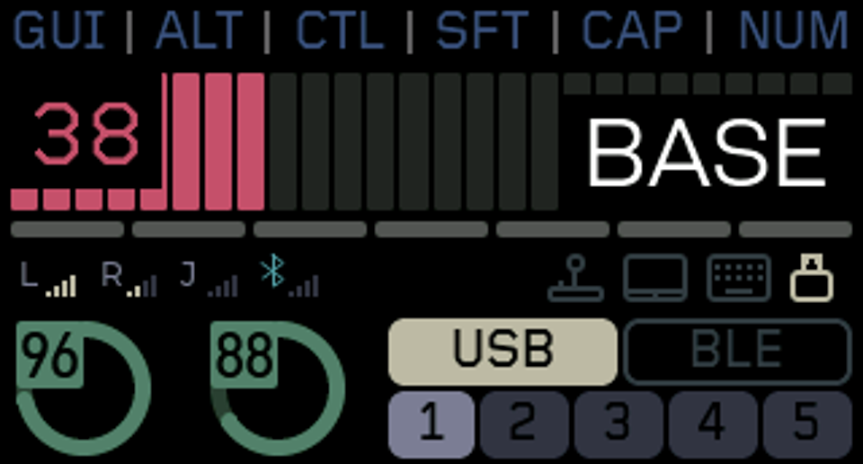

# LisM 双 Dongle：A 实测基准与 XIAO147 横屏更新

一套左手四向杆＋右手轨迹球，可在 A（Prospector 1.69 英寸）与 B（XIAO147 带触摸）之间使用。保留接收器 USB／5 个 BLE 主机配置，以及通过右手直连主机的另外 5 个 BLE 配置。

## 当前版本与下载

- **已实测基准：左手 v5.0.4.14＋右手 v5.0.4.17＋A v5.0.4.17。** 用户确认两种模式的按键、四向杆、轨迹球、直连 L 信号、L／R／J／蓝牙顺序，以及 A 的 WPM 归零和直连 BLE 配色正常。这是本轮功能测试结果，不代表长期无线稳定性或测得 1ms 延迟。
- **B v5.0.4.18 FULL TEST：已编译、软件审核通过，待实机验证。** 按 A 当前布局重排成 320×172 原生横屏，内容宽312px，两侧各4px；WPM、七个层条、信号与模式图标、底部双电量环及 USB／BLE 五槽互不覆盖。使用双20%绘制缓冲，每块22016B，保留32768B图形池，并同步 WPM 归零时的一次局部重画。

**B v5.0.4.18 已知问题：实机画面正常，但在 Dongle B 模式下右手轨迹球比 A 明显延迟，主页和静态 DEVICES 页均可出现；同套左右手在键盘直连 BLE 模式正常。正在定位，此包仅用于复现和测试，不能作为 B 的功能通过或稳定基准。**

[下载 B v5.0.4.18 测试包](firmware/LisM_ESB_v50418_XIAO147_FULL_TEST.zip?raw=true) · [下载 A／右手 v5.0.4.17 包](firmware/LisM_ESB_v50417_LEFT_RSSI_TEST.zip?raw=true)

## 本轮刷写

目前已用上述 A／左右手基准的设备，**只刷 B**：`LisM_ESBv50418_FULL_TEST_Dongle_B_XIAO147_Touch.uf2`。A 和左右手无需更新，不清配对，不刷 settings reset。双击 B 的 Reset 进入启动盘，复制对应 UF2，等待自动重启。不要把 A／B 文件交叉刷入。

B 包含回退用的上一份已编译 B v5.0.4.17 文件；它不是新的实机稳定基准。包内校验表用于核对下载完整性。

首轮在 B 验证：满屏布局、触摸切页、WPM 上升后回到0无残影、直连 BLE 按钮配色、搜索／长设备名／PIN 配对弹窗，以及两种输入模式。保留固定100%亮度、不自动休眠；仅 STATUS／DEVICES 两页，不含六轴、飞鼠、自动旋转。

## 按键与连接

Device 层进入方式和200ms配置沿用原键图。下表指基础层对应的物理键位置。

| 按键 | 功能 | 定义 |
| --- | --- | --- |
| Device＋右手 F1／F2 | 选择 A／B 站 | `&kb_route KB_DONGLE_SEL(0)`／`(1)` |
| Device＋H | 键盘经右手直连 BLE 主机 | `&kb_route KB_BLE` |
| Device＋分号 | 返回 Dongle | `&kb_route KB_DONGLE` |
| Device＋N／M／逗号／句号／斜线 | 键盘直连 BLE 的1～5槽 | `&kb_route KB_BLE_SEL(0)`～`(4)` |
| Device＋E | STATUS／DEVICES 切页 | `&screen_next` |

Dongle 模式：左手、右手分别经 ESB 直达当前接收器。键盘直连模式：左手经 ESB 到右手，由右手 BLE 连接主机；有电的接收器可继续显示状态。

开机优先探测 Dongle；不可达则回退直连 BLE。进入直连后，随后开机的 Dongle 不抢走输入。两个站都在附近时保持当前连接，按键可手动选站。切换需先松开按键和鼠标按钮。A、B、键盘直连各自保存主机配对，配置位不互相复制。

## 图标与第三方输入

信号顺序为 **L／R／J／蓝牙**。Dongle 模式 L／R 来自左右手直达接收器的链路；键盘直连时 L 是左手→右手的信号，由已有状态包转报，R 是右手→接收器状态链路。J 表示第三方 BLE JP19／Circlepad；蓝牙表示其他第三方 BLE 输入设备，不是接收器与电脑之间的 BLE 信号。没有对应设备连接时灰色正常。

四个模式图标依次为摇杆、鼠标／触摸板、键盘直连、Dongle。摇杆及触摸板图标按已连接且 ready 的设备状态高亮；图标识别不等同于所有外设功能已实机支持。

在 DEVICES 页开启 BLE inputs，选择空位开始搜索，外设须断开其他主机并进入配对模式。仅主动搜索期间添加设备；已保存设备自动重连。关闭开关则停用第三方 BLE 输入。左四向杆导航，基础层 Enter 确认；XIAO147 保留触摸操作。

## 验证与边界

B 的实际 ARM ELF 静态 RAM 为230720B／262144B（88.0%）；两个绘制缓冲各22016B，图形池32768B。静态未分配31424B不是实测运行期余量。

实际 LVGL＋JD9853A 驱动转换＋Zephyr 刷屏函数的 native 模型通过547次缓冲不可变核对、104个自然完成帧与完整重画对照、12次切页往返及数字／峰值归零。32位、32768B图形池模型覆盖搜索、配对弹窗和40次切页：最低空闲2880B、最大连续空闲2824B，切页后的稳态内存恢复。这些模拟不覆盖物理 SPI、电气、无线时序或实机全部堆栈。

A 双缓冲和显示效果已由用户确认；B 同步改动仍需实机确认。未据此证明旧单缓冲是所有异常的唯一原因。

## 构建

沿用 `codex/esb-v50-dual-dongle` 分支和固定依赖，使用 `tools/build_upstream_esb.py` 的 `left`、`right`、`dongle_a`、`dongle_b`、`reset` 目标。B 本轮未改无线参数、键图、配对存储或触摸驱动。精确文件哈希、源码指纹及验证摘要见下载包。原作者说明见 [README.upstream.md](README.upstream.md)。
